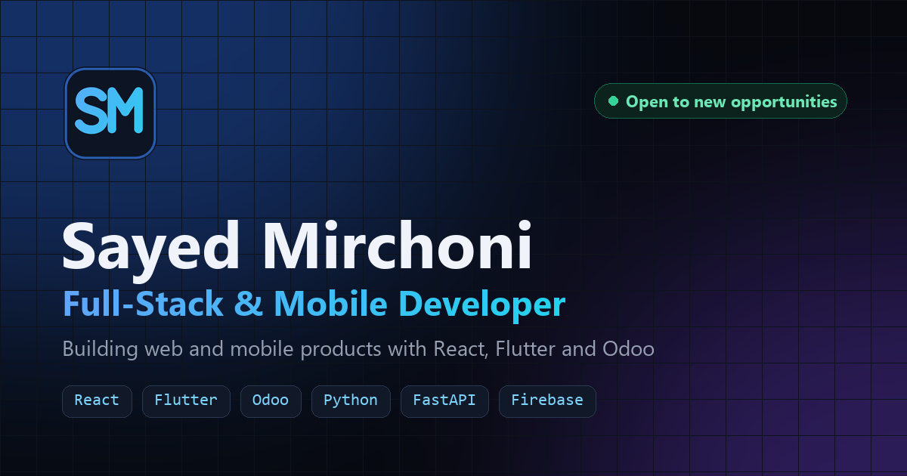

# Sayed Mirchoni · Portfolio

Personal portfolio of **Sayed Mirchoni**, a full-stack and mobile developer from Karnataka, India, and a 2026 Computer Science graduate. I build web and mobile products with React, Flutter, Odoo and Python.

**Live site:** https://sayedmirchoni-portfolio.vercel.app/



## Highlights

- **Company work and personal projects** in one grid, with a details panel for each: overview, key highlights, system overview and tech stack. Private company projects show a "Company Project" badge instead of public links.
- **Blast-door splash screen** (about 2 seconds) that hands off to the site using GPU-friendly transforms.
- **Starfield background** on a canvas with depth layers, parallax and reduced-motion support.
- **Filterable skills showcase** with brand icons and animated proficiency bars.
- **Working contact form** that sends a branded HTML email through a Vercel serverless function, with validation, rate limiting and a spam honeypot.
- **AI assistant** that answers visitors' questions about my work, using only the portfolio's own data (Groq or OpenAI, via a serverless function).
- **Ctrl/⌘ + K quick menu** to jump to sections, open projects, open the resume or copy the email address.
- **Accessibility:** keyboard-friendly dialogs, visible focus states and `prefers-reduced-motion` support throughout.
- **SEO:** page metadata, Open Graph preview image, structured data (JSON-LD), sitemap and favicons for every platform.

## Tech stack

| Area | Tools |
| --- | --- |
| Framework | React 18, TypeScript, Vite |
| Styling | Tailwind CSS v4, shadcn/ui (Radix UI) |
| Motion | Framer Motion, Web Animations API, Lenis smooth scroll |
| Forms | React Hook Form, Zod |
| Email | Vercel serverless function, Nodemailer (Gmail) |
| AI assistant | Groq (free tier, `openai/gpt-oss-120b`) or OpenAI (`gpt-5.4-mini`), via the Chat Completions API |
| Hosting | Vercel, Vercel Web Analytics |

## Project structure

```
api/                     Vercel serverless functions (contact form + email template)
backend/                 Optional local Express server for the contact form
public/                  Static assets: resume, images, icons, sitemap, OG image
src/
  components/
    layout/              Header, footer, background, command menu
    portfolio/           Page sections (hero, projects, experience, skills, about, contact)
    ui/                  shadcn/ui primitives and the splash screen
  data/developer.ts      All portfolio content: profile, experience, skills, projects
  lib/                   Helpers (smooth scrolling, experience calculation)
```

Most content changes only need `src/data/developer.ts`.

## Run locally

```bash
npm install
npm run dev          # http://localhost:8080
npm run typecheck    # TypeScript check
npm run build        # production build in dist/
```

### Contact form

On Vercel the form posts to `api/contact.js`. Set these environment variables in **Vercel → Project → Settings → Environment Variables**:

| Variable | Value |
| --- | --- |
| `EMAIL_USER` | Gmail address that sends the email |
| `EMAIL_PASS` | Gmail App Password |
| `RECIPIENT_EMAIL` | Where messages are delivered (optional, defaults to `EMAIL_USER`) |

### AI assistant

The chat widget posts to `api/chat.js`, which answers from `api/_knowledge.js`. That file is generated from `src/data/developer.ts` automatically before `npm run dev` and `npm run build` (or run `npm run chat:knowledge`), so the assistant always matches the site.

| Variable | Value |
| --- | --- |
| `GROQ_API_KEY` | Groq API key, free at [console.groq.com/keys](https://console.groq.com/keys). Used if set. |
| `OPENAI_API_KEY` | OpenAI API key (alternative, paid) |
| `CHAT_MODEL` | Optional model id override (defaults: `openai/gpt-oss-120b` on Groq, `gpt-5.4-mini` on OpenAI) |

For local development, copy `backend/.env.example` to `backend/.env`, fill in the same values, and run `npm start` inside `backend/`. The Vite dev server proxies `/api` to it.

## Contact

- GitHub: [Sayednaayaab](https://github.com/Sayednaayaab)
- LinkedIn: [sayed-mirchoni](https://www.linkedin.com/in/sayed-mirchoni/)
- Or use the contact form on the live site.
